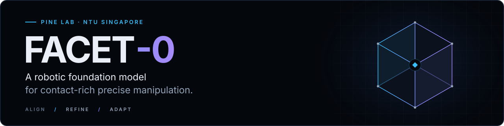

<p align="center">
  <a href="https://pine-lab-ntu.github.io/facet-0/"></a>
</p>

<div align="center">

**A Robotic Foundation Model for Contact-Rich Precise Manipulation**

[Haoyuan Deng](https://denghaoyuan123.github.io/)<sup>*</sup> · [Haichao Liu](https://henryhcliu.github.io/)<sup>*</sup> · [Wenkai Guo](https://wkguo.github.io/)<sup>*</sup> · [Yuan Ling](https://u-li-li.github.io/lingyuan.github.io/) · [Zaijia Yang](https://yangzaijia.github.io/) · [Yuanjiang Xue](https://xuanyuan-jiang.github.io/) · Haosheng Sun · Liangzi Wang · [Ziwei Wang](https://ziweiwangthu.github.io/)<sup>†</sup>

**PINE Lab · Nanyang Technological University, Singapore**<br>
<sub>* Equal contribution · † Corresponding author</sub>

[Project](https://pine-lab-ntu.github.io/facet-0/) &nbsp; / &nbsp; [Paper](https://arxiv.org/abs/2609.01596) &nbsp; / &nbsp; [Model](https://huggingface.co/Pinelab/Facet-0) &nbsp; / &nbsp; [ManuFacet-1K](https://huggingface.co/datasets/Pinelab/ManuFacet-1K)

</div>

## Overview

Facet-0 predicts and values the contact consequences of its actions. Vision, language, kinematics and causal wrench history condition a joint **action–wrench proposal**: Cartesian actions are executed; future wrench remains a prediction.

This repository provides the three-stage learning pipeline and policy interfaces:

| Stage | Purpose | Implementation |
| :--- | :--- | :--- |
| **01 · Align** | Joint action–wrench flow matching with alternating VQA supervision | [Pretraining](facet0/pretraining/) |
| **02 · Refine** | Distributional values, contact-selective credit and guided policy updates | [Refinement](facet0/refinement/) |
| **03 · Adapt** | Frozen contact tokens and bounded local actor–critic learning | [Online adaptation](facet-online-adaptation/) |

## Quick start

Use **Python 3.11** and the pinned OpenPI checkout below. JAX and PyTorch may also run in separate environments; see the [setup and training guide](docs/getting_started.md).

```bash
git clone https://github.com/PINE-Lab-NTU/FACET.git
git clone https://github.com/Physical-Intelligence/openpi.git
git -C openpi checkout 650c5b0283a49c42784fb5055a0507da2c6d347d
cd FACET
pip install --no-deps -e ../openpi -e ../openpi/packages/openpi-client
pip install -e '.[policy,test]' -e './facet-online-adaptation[test]'
```

Run the complete CPU example in a new output directory:

```bash
export PYTHONPATH="$PWD/../openpi/src:$PWD/../openpi/packages/openpi-client/src"
JAX_PLATFORMS=cpu python examples/small_pipeline.py --output-dir /tmp/facet-small
```

The [example](examples/) trains small networks on synthetic data and verifies checkpoints, critic learning, token reconstruction, BC → RL → frozen evaluation, and coarse/refinement scheduling. Full-scale training uses external data, weights, judge models and robot controllers.

## Documentation

[Training & serving](docs/getting_started.md) · [Model interfaces](docs/implementation_notes.md) · [Paper mapping](docs/paper_map.md) · [Changes](CHANGES.md)

## Citation

```bibtex
@article{deng2026facet0,
  title   = {Facet-0: A Robotic Foundation Model for Contact-Rich Precise Manipulation},
  author  = {Deng, Haoyuan and Liu, Haichao and Guo, Wenkai and Ling, Yuan and
             Yang, Zaijia and Xue, Yuanjiang and Sun, Haosheng and Wang, Liangzi and Wang, Ziwei},
  journal = {arXiv preprint arXiv:2609.01596},
  year    = {2026}
}
```

[Apache-2.0](LICENSE). Upstream code, model weights and datasets retain their respective terms.<br>
Research and collaboration: [ziwei.wang@ntu.edu.sg](mailto:ziwei.wang@ntu.edu.sg).
